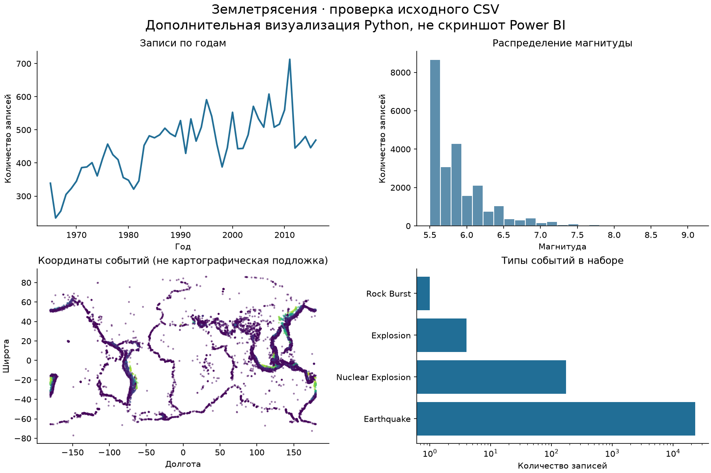

# Проекты по анализу данных

Учебные работы Симоны Бакич: исследование сейсмических событий, отчёт Power BI и подготовка данных о недвижимости Melbourne.

**Инструменты:** Power BI, DAX, TMDL, Yandex DataLens, Loginom, Python.

## Проекты

| Проект | Задача | Материалы |
|---|---|---|
| Сейсмические события | Изучить географию, магнитуду, глубину и распределение записей по годам | [Отчёт Power BI](power-bi/earthquakes.pbix), [разбор](power-bi/README.md), [DataLens](https://datalens.yandex/tubhmby9pphsc?_share_link=public) |
| Недвижимость Melbourne | Обработать пропуски, изучить признаки и оценить базовую регрессию цены | [Предобработка](melbourne/README.md), [сценарий Loginom](loginom/melbourne-original.lgp), [разбор](loginom/README.md) |

## Пример анализа



На рисунке — дополнительная визуализация Python; отчёт Power BI доступен в PBIX, интерактивный дашборд — по ссылке DataLens.

Независимый расчёт исходного CSV: **23 412 уникальных событий** за 1965–2016 годы, из них **23 232 — Earthquake**. Максимум записей за год в этом наборе — 713 в 2011 году. Это характеристика набора, а не доказательство роста глобальной сейсмической активности.

Для Melbourne отдельно проверена модель цены по площади: 5 398 обучающих и 1 350 тестовых строк, тестовый **R² ≈ 0,344**. Одной площади недостаточно для точного прогноза.

## Структура

- [power-bi](power-bi) — PBIX, DAX-запросы, TMDL и определения визуализаций.
- [melbourne](melbourne) — графики и результаты предобработки.
- [loginom](loginom) — исходный сценарий и разбор преобразований.
- [scripts](scripts) — независимые расчёты на Python.
- [results](results) — сохранённые метрики и сводки.

## Воспроизведение расчётов

Команды для PowerShell:

```powershell
python -m venv .venv
.\.venv\Scripts\Activate.ps1
python -m pip install -r requirements.txt
# Поместите CSV в data/earthquakes.csv и data/melb_data.csv.
python scripts/analyze.py
python scripts/plot_preview.py
```

Контрольные суммы исходных CSV: [source-hashes.json](data/source-hashes.json). CSV не включены в репозиторий; первоисточник и условия повторного распространения отдельно не проверялись. Для обновления данных PBIX требуется настроить путь в Power Query.

## Проверка и ограничения

Проверены структура PBIX, 8 визуализаций, 4 DAX-запроса и 2 TMDL-скрипта. Сценарий Loginom прочитан из LGP, CSV пересчитаны отдельно. Полный пересчёт в Power BI Desktop и повторный запуск сценария в Loginom не выполнялись. Предложенные определения мер в разборе не выдаются за извлечённые формулы бинарной модели.

Оформление и независимые проверки подготовлены с помощью AI-инструментов. Исходные учебные материалы сохранены.
