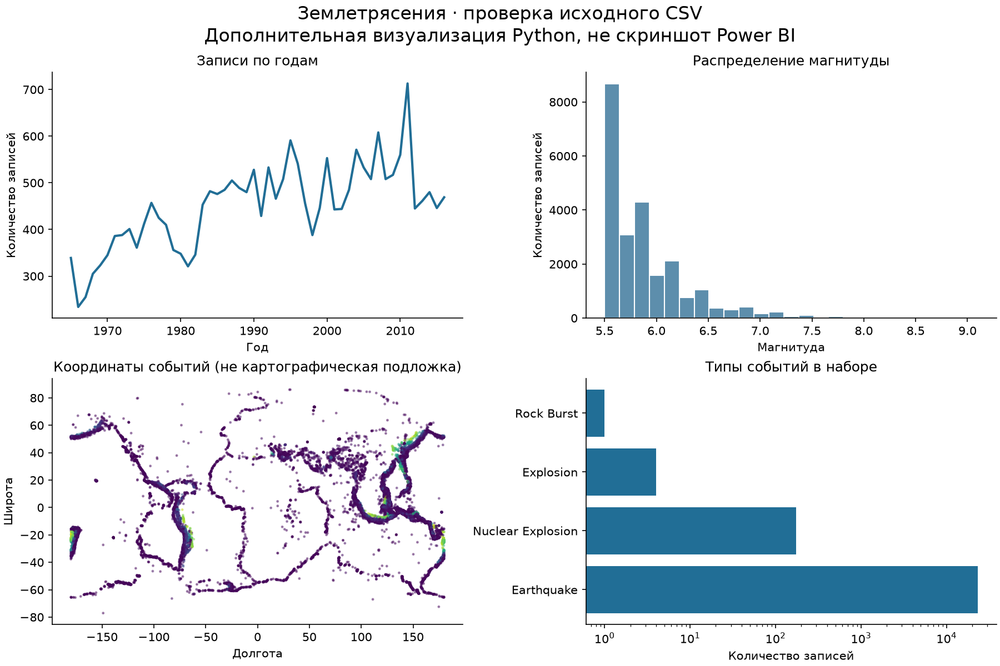

# Учебные проекты по анализу данных

Работы Симоны Бакич по оперативному анализу данных: **Power BI, DAX, TMDL, Yandex DataLens, Loginom и Python**. Здесь собраны исходные отчёты, проверяемые определения и небольшая воспроизводимая проверка данных. Это учебные кейсы, не опыт коммерческого внедрения.

## Землетрясения — Power BI и DataLens

**Задача:** исследовать состав набора сейсмических событий, распределение магнитуды и глубины, географию и изменения числа записей по годам.

- [Отчёт Power BI](power-bi/earthquakes.pbix)
- [Публичный дашборд DataLens](https://datalens.yandex/tubhmby9pphsc?_share_link=public)
- [Разбор отчёта, расчётов и ограничений](power-bi/README.md)
- [Четыре сохранённых DAX-запроса](power-bi/dax) и [два TMDL-скрипта](power-bi/tmdl)



Изображение выше — дополнительная визуализация Python по исходному CSV, **не скриншот Power BI**. Сам интерактивный отчёт находится в PBIX, а публичная ссылка открывает DataLens.

По независимому расчёту исходного CSV: 23 412 уникальных событий за 1965–2016 годы; 23 232 относятся к типу Earthquake. В наборе есть и другие события, поэтому количество всех строк нельзя без уточнения называть количеством землетрясений. Максимум записей за год в этом наборе — 713 в 2011 году. Это наблюдение о составе набора, а не доказательство роста глобальной сейсмической активности.

## Melbourne — Loginom и проверка регрессии

- [Исходный сценарий Loginom](loginom/melbourne-original.lgp)
- [Разбор преобразований и найденной несогласованности](loginom/README.md)
- [Независимая воспроизводимая оценка Python](scripts/analyze.py)
- [Метрики проверки](results/melbourne-baseline.json)
- [Предобработка Melbourne](melbourne/README.md)

Сценарий включает производные признаки, фильтрацию, корреляцию Пирсона, разделение выборки и линейную регрессию. Проверка Python отдельно обучает простую модель цены по площади: 5 398 обучающих и 1 350 тестовых строк, тестовый R² ≈ 0,344. Это базовая модель; большая ошибка показывает, что одной площади недостаточно для точного прогноза.

## Воспроизведение проверки

```powershell
python -m venv .venv
.\.venv\Scripts\Activate.ps1
python -m pip install -r requirements.txt
# Поместите исходные CSV в data/earthquakes.csv и data/melb_data.csv
python scripts/analyze.py
python scripts/plot_preview.py
```

Контрольные SHA-256 исходных CSV находятся в [data/source-hashes.json](data/source-hashes.json). CSV не добавлены в Git: они предоставлены автором локально; первоисточник и условия повторного распространения отдельно не проверялись. PBIX содержит сохранённую учебную модель; для обновления источника потребуется настроить путь в Power Query.

## Что проверено

Структура PBIX: 8 элементов визуализации, 4 DAX-запроса, 2 TMDL-скрипта. Сценарий Loginom прочитан из LGP, исходные CSV пересчитаны отдельно. Полный пересчёт модели в Power BI Desktop и повторный запуск Loginom в редакторе не выполнялись. Формулы мер из бинарной модели PBIX не извлечены: предложенные определения в разборе не выдаются за существующие.

Материалы для портфолио и независимые проверки подготовлены с помощью AI-инструментов. Исходные лабораторные файлы сохранены; замечания к ним описаны открыто.
